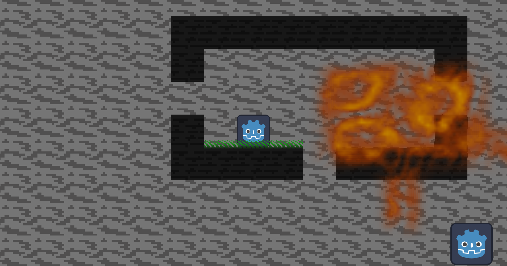
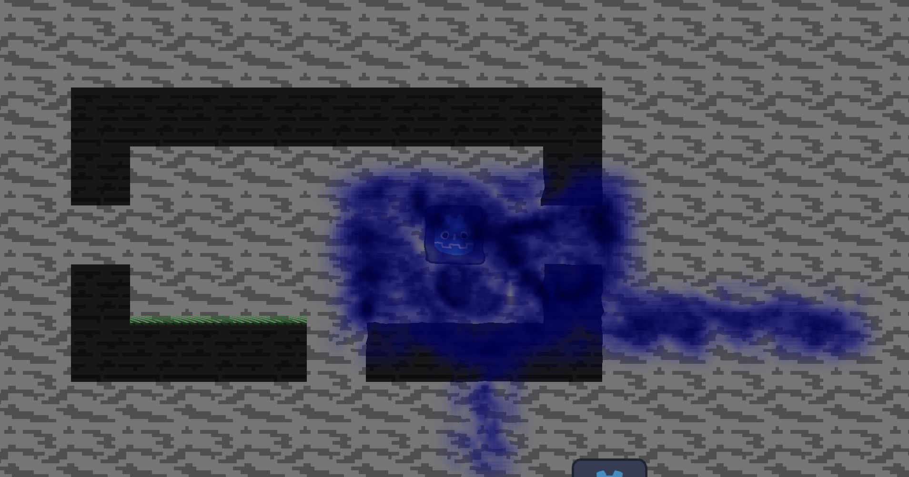

# **Godot Shader Assets**
## A couple cool Godot shaders you can use

This is my first time using Godot and I spent most of the time making some cool shaders. By far the coolest one is the magic/fire shader.
The magic shader uses a tileMapLayes as the mask for where to apply it so it is fairly versitile.

You can test the project with the itch web link (https://github.com/Robodog81/Cool-Godot-Shader-Assets) but the animations for the magic shader don't work due to it using Godot 3D noise.
You can either run the files in Godot or try using the windows build on itch. I have not tested it as I am using linux.

## **Magic Shader**
This is the primary part of this project, It is fairly customisable and looks really cool in my opinion.\
\
**How to edit**
* To edit the patterns that the texture form you can change the quick nose lite properties in the 'Smooth Shader Tiles' node.
* To edit the speed of the animation you can change the 'speed' variable in the script attached to the 'Smooth Shader Tiles' node.
* To edit the colours of the magic you can go to the 'Magic Shader' shader and edit the variables: primaryColor, secondaryColor, and colourTransttion.\
The var primaryColour is the base colour of the magic, secondaryColour is the colour at the strongest points of the magic, colourTransttion is how far along the magic changes from primaryColour to secondaryColor.

## **Grass Shader**
The project has a simple grass shader that I made that uses sin waves to make an animated grass texture. I made this as a quick test so it is quite simple.

## **Use**
Feel free to use the shaders in this project for your own but please provide credit.
